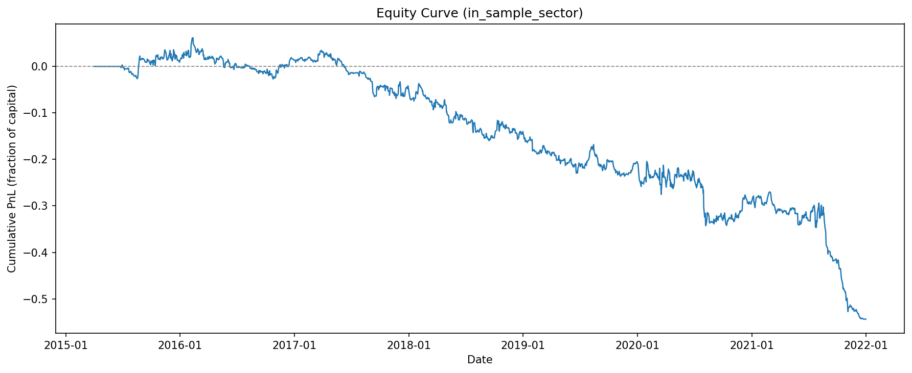
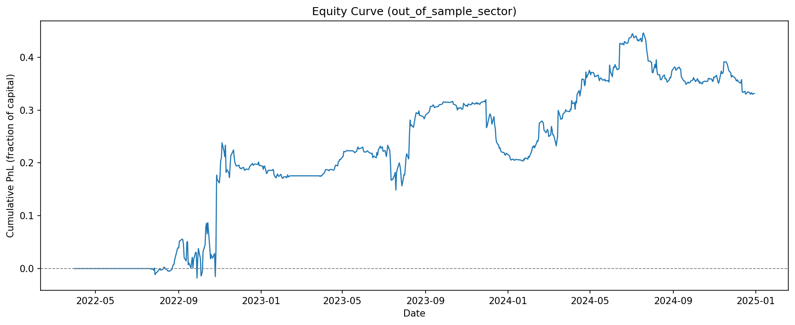
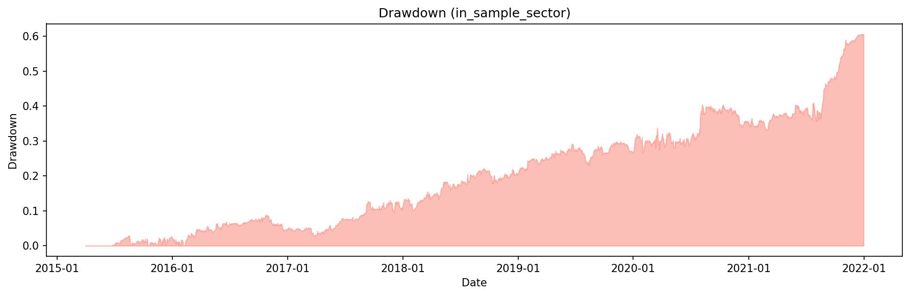
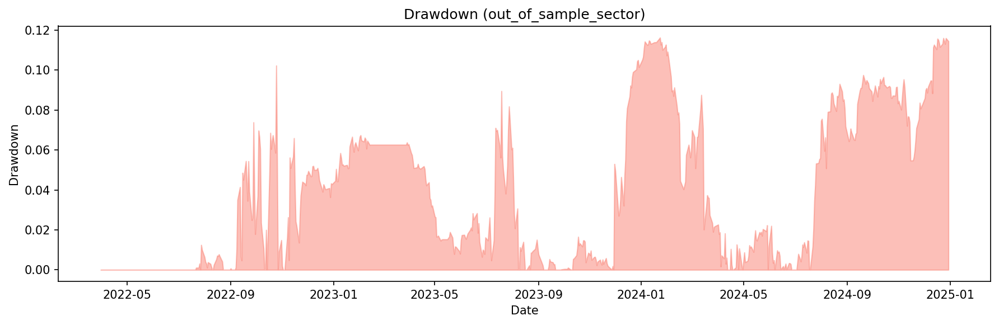
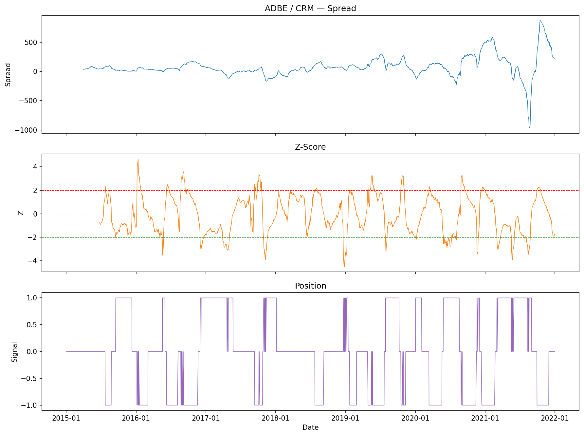
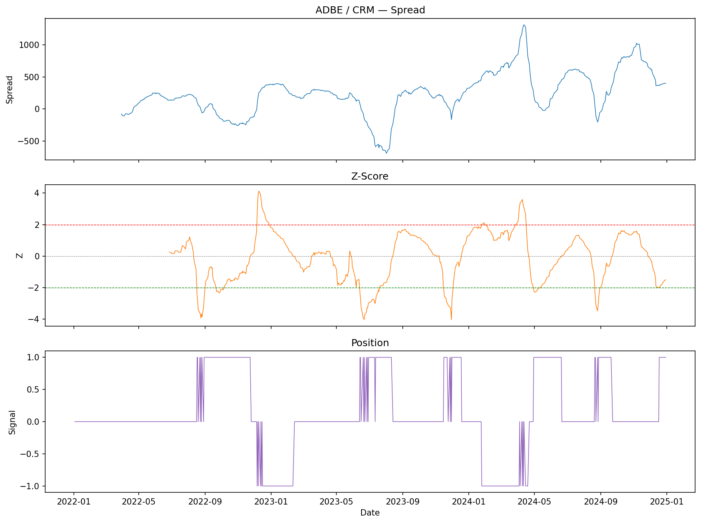
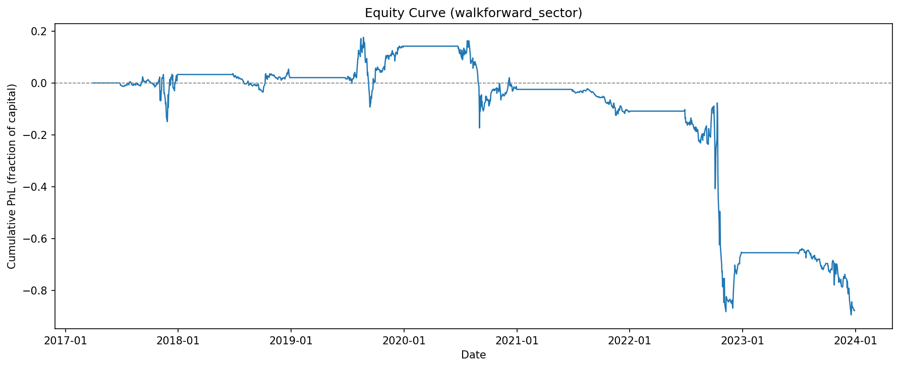
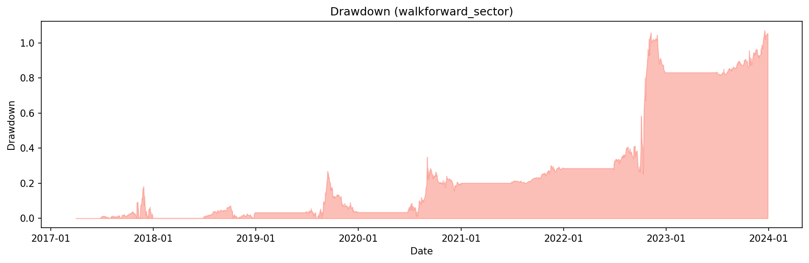

# Pairs Trading Backtest

Statistical arbitrage backtest using Engle-Granger cointegration on S&P 500 equities.
The project tests whether cointegration-based pair selection produces tradeable mean-reversion signals, and investigates why it fails or succeeds under different configurations.

## Setup

Universe of 54 liquid S&P 500 stocks across 10 sectors. Price data from Yahoo Finance (2015–2024). Pairs are selected on in-sample data via pairwise Engle-Granger cointegration tests (p < 0.05), filtered by mean-reversion half-life (5–60 trading days), and ranked by test statistic. Signals use a rolling 60-day OLS hedge ratio, z-score entry at |z| > 2, exit at mean reversion or stop-loss at |z| > 3. Execution assumes a 1-day fill delay and 5 bps transaction cost per leg.

Look-ahead bias is controlled at every stage:

| Component | Prevention |
|---|---|
| Pair selection | Uses only in-sample data; frozen for OOS |
| Hedge ratio | Rolling OLS on [t−60, t−1] |
| Z-score | Rolling mean/std shifted by 1 day |
| Execution | 1-day fill delay |
| Automated test | `test_look_ahead.py` truncates data at day t and verifies signals match full-sample output |

## Results

### Step 1: Baseline (all pairs)

In-sample: 2015–2021. Out-of-sample: 2022–2024. All C(54,2) = 1,431 pairs tested regardless of sector.

| Metric | In-Sample | Out-of-Sample |
|---|---|---|
| Annualized Return | −10.6% | +0.05% |
| Sharpe Ratio | −1.24 | 0.006 |
| Max Drawdown | 76.4% | 18.7% |
| Win Rate | 44.4% | 47.9% |

OOS Sharpe is essentially zero. Inspecting the selected pairs reveals the problem: many top-ranked pairs (e.g., HD/LIN, DUK/MCD) are cross-sector coincidences. These pairs pass the cointegration test in-sample but have no shared economic driver to sustain the relationship out-of-sample.

<p float="left">
  
  
</p>

<p float="left">
  
  
</p>

**Example — HD / LIN** (t-stat = −4.92, half-life = 31 days). Cross-sector pair: consumer discretionary vs. materials. Cointegration weakens out-of-sample.

<p float="left">
  
  
</p>

### Step 2: Sector constraints

Hypothesis: restricting pairs to within the same sector should improve OOS stability, because same-sector pairs share fundamental drivers (e.g., enterprise software spending for ADBE/CRM, consumer staples pricing for KO/PEP).

The sector filter reduces the search space from 1,431 to ~200 pairs and selects only 6 pairs that pass all filters.

| Metric | Baseline OOS | Sector OOS | Change |
|---|---|---|---|
| Annualized Return | +0.05% | +12.1% | +12.0 pp |
| Sharpe Ratio | 0.006 | 0.70 | +0.69 |
| Max Drawdown | 18.7% | 11.6% | −7.1 pp |
| Win Rate | 47.9% | 51.0% | +3.1 pp |

Sector constraints turn a flat strategy into a profitable one. The surviving pairs — KO/PEP, ADBE/CRM, ABBV/UNH — have economic justification for long-term cointegration. Max drawdown drops from 18.7% to 11.6%.

In-sample performance remains negative (Sharpe = −0.96) under both configurations. The 2015–2021 period was a sustained bull market where tech stocks diverged from the rest of the universe. Mean-reversion strategies do not work when assets trend — this is a known regime dependence, not a bug.

<p float="left">
  
  
</p>

<p float="left">
  
  
</p>

**Example — ADBE / CRM** (t-stat = −4.75, half-life = 30 days). Both are SaaS/cloud companies driven by enterprise software spending.

<p float="left">
  
  
</p>

### Step 3: Walk-forward re-selection (negative result)

Hypothesis: cointegration relationships may decay over time. Re-running pair selection annually on a rolling 2-year lookback (instead of selecting once on 7 years) should keep pairs fresh.

Walk-forward windows: 2-year lookback, 12-month trading period, stepped annually from 2015–2024. Sector constraints applied.

| Metric | Sector OOS (static) | Walk-Forward (2017–2024) |
|---|---|---|
| Annualized Return | +12.1% | −16.6% |
| Sharpe Ratio | 0.70 | −0.57 |
| Max Drawdown | 11.6% | 107.0% |
| Win Rate | 51.0% | 47.1% |

Walk-forward re-selection makes performance worse. Two factors explain this:

1. **Regime exposure.** The walk-forward forces trading through the 2017–2021 bull market, where mean-reversion loses money regardless of pair quality. The static approach avoids this by selecting on 2015–2021 and only trading 2022–2024.

2. **Shorter lookback, noisier selection.** A 2-year lookback produces less reliable cointegration estimates than a 7-year window. Even the 2022–2024 segment of the walk-forward loses money, whereas the static sector-constrained version achieves Sharpe 0.70 on that same period.

The binding constraint on this strategy is market regime, not pair staleness. Walk-forward re-selection addresses the wrong problem.

<p float="left">
  
  
</p>

## Methodology

**Universe.** 54 liquid S&P 500 stocks across 10 sectors. Fixed at current constituents; survivorship bias is present (see [Limitations](#limitations)).

**Pair selection.** Pairwise Engle-Granger cointegration tests on in-sample data, filtered at p < 0.05. Mean-reversion half-life computed via AR(1) on the OLS spread, required to be between 5 and 60 trading days. Top 20 pairs by test statistic are selected and frozen for out-of-sample evaluation. With sector constraints enabled, only within-sector pairs are tested.

**Signal generation.** Rolling 60-day OLS hedge ratio (no look-ahead: window is [t−60, t−1]). Z-score computed with shifted rolling statistics. Entry at |z| > 2, exit at mean reversion (z crosses 0) or stop-loss (|z| > 3). Position signals use a state machine with hysteresis to avoid excessive turnover near thresholds.

**Execution.** Signal at close t, fill at close t+1. Transaction costs at 5 bps per leg per side. Equal-weight allocation across pairs.

## Next Steps

1. **Regime filter.** Use a market-wide trend indicator (e.g., rolling 60-day SPY return) to reduce exposure during strong trends. The walk-forward experiment confirmed that regime is the primary driver of losses.
2. **Kalman filter hedge ratio.** Replace rolling OLS with a Kalman filter for adaptive, smoother hedge ratios.
3. **Parameter sensitivity.** Sweep entry/exit thresholds, lookback window, and number of pairs.

## Limitations

- **Survivorship bias.** Universe uses current S&P 500 constituents. Delisted stocks are excluded.
- **No capital model.** Equal-weight additive returns; no leverage, margin, or portfolio risk constraints.
- **No slippage model.** Costs are fixed basis points. No market impact modeling.
- **No regime awareness.** Full exposure in all market conditions.

## Project Structure

```
├── config.py                  # Parameters and sector map
├── src/pairs/
│   ├── data.py                # Download, cache, clean
│   ├── selection.py           # Engle-Granger screening, half-life filter
│   ├── signals.py             # Rolling hedge ratio, z-score, state machine
│   ├── backtest.py            # PnL and costs
│   ├── metrics.py             # Sharpe, drawdown, win rate
│   └── plots.py               # Equity curve, drawdown, spread plots
├── scripts/run_backtest.py    # Entry point (baseline, sector, walk-forward)
├── tests/                     # Unit and look-ahead tests
└── results/                   # Figures and CSVs
```

## Reproduce

```bash
pip install -r requirements.txt
python scripts/run_backtest.py
python -m pytest tests/ -v
```

First run downloads from Yahoo Finance (~1 min) and caches to `data/prices.parquet`.

## References

- Gatev, Goetzmann & Rouwenhorst (2006). *Pairs Trading: Performance of a Relative-Value Arbitrage Rule.* Review of Financial Studies.
- Engle & Granger (1987). *Co-integration and Error Correction: Representation, Estimation, and Testing.* Econometrica.
- Avellaneda & Lee (2010). *Statistical Arbitrage in the U.S. Equities Market.* Quantitative Finance.
