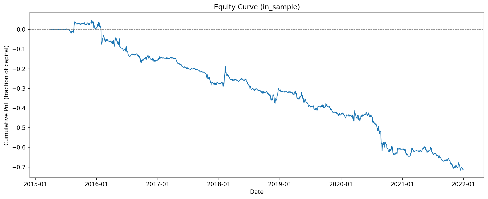
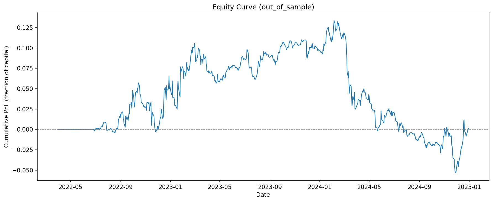
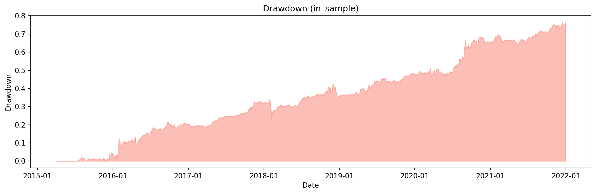
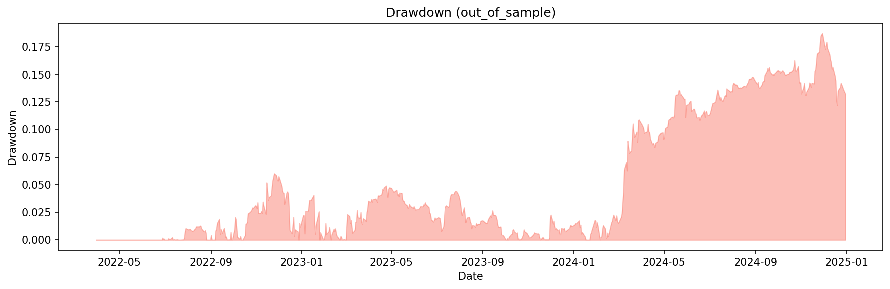
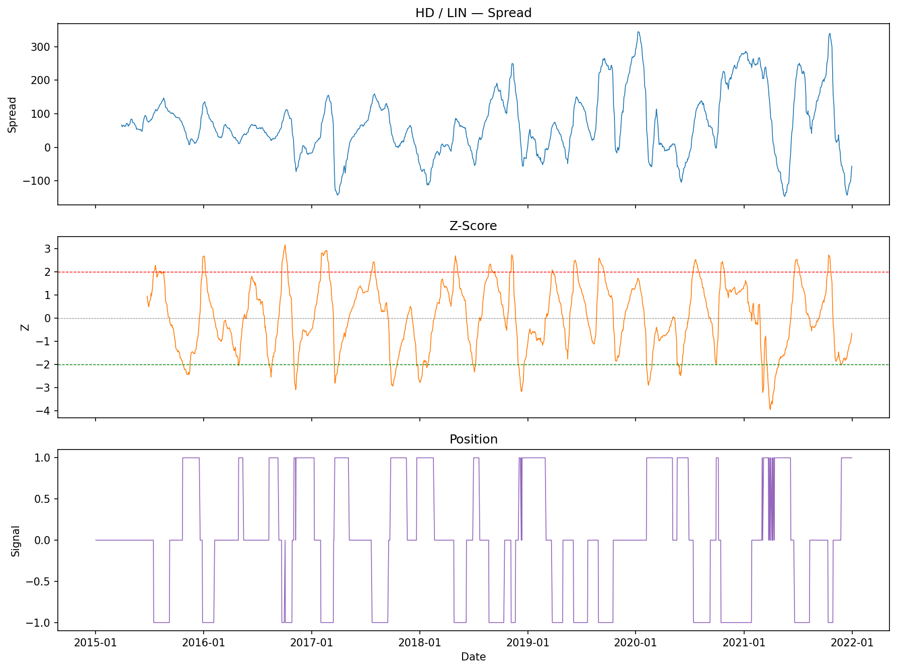
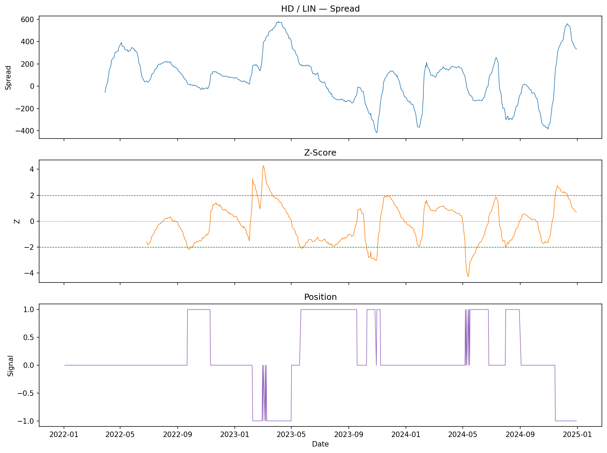

# Pairs Trading Backtest

Statistical arbitrage strategy using Engle-Granger cointegration on S&P 500 equities. Full backtest with in-sample pair selection (2015–2021) and clean out-of-sample evaluation (2022–2024).

## Results

### Out-of-Sample Performance (2022–2024)

| Metric | Value |
|---|---|
| Annualized Return | 0.05% |
| Sharpe Ratio | 0.006 |
| Max Drawdown | 18.7% |
| Win Rate | 47.9% |

### In-Sample Performance (2015–2021)

| Metric | Value |
|---|---|
| Annualized Return | −10.6% |
| Sharpe Ratio | −1.24 |
| Max Drawdown | 76.4% |
| Win Rate | 44.4% |

### Equity Curves

<p float="left">
  
  
</p>

<p float="left">
  
  
</p>

### Example Pair: HD / LIN

<p float="left">
  
  
</p>

## Methodology

### Universe
54 liquid S&P 500 stocks across 10 sectors. Universe is fixed at today's constituents — survivorship bias is present and disclosed (see [Known Limitations](#known-limitations)).

### Pair Selection
1. Run pairwise Engle-Granger cointegration tests on all C(54,2) = 1,431 pairs using **in-sample data only**.
2. Filter at p < 0.05 significance level.
3. Require mean-reversion half-life between 5 and 60 trading days (reduces false positives from the ~72 expected by chance at 5%).
4. Rank by test statistic, select top 20 pairs.
5. **Pairs are frozen** — no re-selection during out-of-sample.

### Signal Generation
- **Hedge ratio**: Rolling 60-day OLS regression (β estimated on [t−60, t−1]).
- **Spread**: s_t = y_t − β_t · x_t
- **Z-score**: (s_t − μ) / σ where μ and σ are rolling 60-day statistics shifted by 1 day.
- **Entry**: Long spread when z < −2; short spread when z > +2.
- **Exit**: Mean reversion (z crosses 0) or stop-loss at |z| > 3.

### Execution Model
- Signal computed at close of day t, filled at close of day t+1.
- Transaction costs: 5 bps per leg per side (10 bps round-trip per pair).
- Equal-weight allocation across all selected pairs.

## Look-Ahead Bias Controls

This backtest is designed to prevent look-ahead bias at every stage:

| Component | How bias is prevented |
|---|---|
| Pair selection | Engle-Granger tests use only in-sample data; pairs frozen for out-of-sample |
| Hedge ratio | Rolling OLS on [t−60, t−1] — never sees future data |
| Z-score | Rolling mean/std shifted by 1 day |
| Execution | 1-day fill delay (signal at close t, fill at close t+1) |
| **Automated test** | `test_look_ahead.py` truncates data at day t and verifies signals match full-sample computation |

## Project Structure

```
├── config.py                  # All parameters in one place
├── src/pairs/
│   ├── data.py                # yfinance download, cache, clean
│   ├── selection.py           # Engle-Granger screening, half-life filter
│   ├── signals.py             # Rolling hedge ratio, z-score, state machine
│   ├── backtest.py            # Positions, costs, PnL
│   ├── metrics.py             # Sharpe, max DD, annualized return, win rate
│   └── plots.py               # Equity curve, drawdown, spread plots
├── scripts/run_backtest.py    # End-to-end entry point
├── tests/
│   ├── test_look_ahead.py     # Truncation test proving no look-ahead
│   ├── test_signals.py        # State machine unit tests
│   └── test_metrics.py        # Metrics sanity checks
└── results/                   # Figures and metrics (committed)
```

## Reproduce

```bash
pip install -r requirements.txt
python scripts/run_backtest.py
```

The first run downloads data from Yahoo Finance (~1 min) and caches it to `data/prices.parquet`. Subsequent runs use the cache.

To run tests:
```bash
pytest tests/ -v
```

## Known Limitations

- **Survivorship bias**: Universe is built from current S&P 500 constituents. Stocks that were delisted or removed between 2015 and 2024 are excluded, which overstates the opportunity set. Sector ETFs would avoid this but reduce tradeable pairs.
- **No capital allocation model**: The backtest uses equal-weight additive returns across pairs, which doesn't model leverage, margin, or portfolio-level risk constraints.
- **Static pair selection**: Pairs are selected once on in-sample data. A walk-forward approach with periodic re-selection would be more realistic.
- **No slippage model**: Transaction costs are modeled as fixed basis points. A more realistic model would include market impact, especially for less liquid names.

## Potential Extensions

- **Kalman filter hedge ratio**: Replace rolling OLS with a Kalman filter for smoother, adaptive hedge ratios.
- **Walk-forward pair selection**: Re-run cointegration tests quarterly on a rolling window.
- **PCA-based approach**: Factor model residuals (Avellaneda & Lee 2010) instead of pairwise cointegration.
- **Parameter sensitivity**: Sweep over entry/exit thresholds, lookback windows, and number of pairs.

## References

- Gatev, Goetzmann & Rouwenhorst (2006). *Pairs Trading: Performance of a Relative-Value Arbitrage Rule.* Review of Financial Studies.
- Engle & Granger (1987). *Co-integration and Error Correction: Representation, Estimation, and Testing.* Econometrica.
- Avellaneda & Lee (2010). *Statistical Arbitrage in the U.S. Equities Market.* Quantitative Finance.
